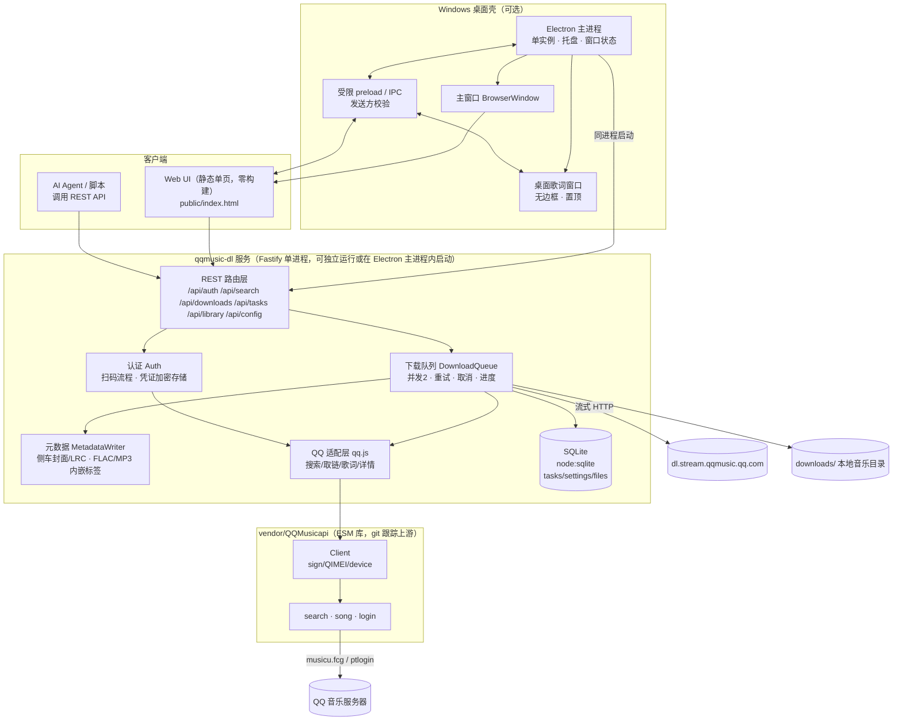
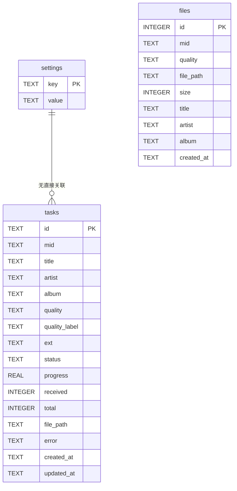

# qqmusic-dl 架构设计

> 版本：v0.2（Windows 桌面版） · 日期：2026-10 · 状态：已定稿

## 1. 需求概要

### 功能性需求

| #   | 需求           | 说明                                                                                              |
| --- | -------------- | ------------------------------------------------------------------------------------------------- |
| F1  | 歌曲搜索       | 输入歌名/歌手/关键词，返回歌曲列表（mid、标题、歌手、专辑、时长、封面）                           |
| F2  | 音质选择与下载 | 17 档音质中选择；VIP 音质依赖登录凭证；无权限时按梯度自动降级（可关闭）                           |
| F3  | 下载队列       | 并发控制（默认 2）、失败重试（指数退避）、进度上报、取消、断点去重                                |
| F4  | 元数据整理     | 所有格式写侧车封面与歌词；MP3/FLAC 额外支持内嵌封面、ID3/Vorbis 标签；命名模板；按歌手/专辑分目录 |
| F5  | 登录管理       | QQ 扫码登录；凭证 AES-256-GCM 加密持久化；过期检测与重新扫码                                      |
| F6  | Web UI         | 单页应用：搜索页 / 任务页 / 媒体库 / 设置                                                         |
| F7  | Agent API      | 完整 REST 接口，供 AI Agent 编程化调度下载（搜索→建任务→查进度）                                  |

### 非功能性需求

- **轻量**：单进程、零原生编译依赖（Node 内置 `node:sqlite`）、无前端构建链
- **本地优先**：默认仅监听 `127.0.0.1`；API 可选 Bearer Token
- **可维护**：上游 QQ 音乐接口变动被隔离在 vendor 适配层内，可整体替换
- **安全**：凭证不明文落盘、不进日志；下载目录路径穿越防护

## 2. 总体架构



### 模块职责

| 模块       | 文件                                                 | 职责                                                                         |
| ---------- | ---------------------------------------------------- | ---------------------------------------------------------------------------- |
| 入口       | `src/server.js`                                      | 目录初始化、DB 初始化、队列启动、路由挂载、优雅退出                          |
| 配置       | `src/config.js`                                      | 环境变量与默认值，路径解析                                                   |
| 数据库     | `src/db.js`                                          | node:sqlite 封装，tasks/settings/files 三表                                  |
| QQ 适配    | `src/qq.js`                                          | Client 单例、音质阶梯、搜索解析、取链（含降级）、歌词解密                    |
| 认证       | `src/auth.js`                                        | 扫码登录状态机、凭证加解密、注入 Client                                      |
| 队列       | `src/queue.js`                                       | 并发worker、重试、取消、进度                                                 |
| 任务       | `src/task.js`                                        | 单任务编排：详情→取链→下载→元数据→落库                                       |
| 元数据     | `src/metadata.js`                                    | 全格式侧车封面/LRC、FLAC Vorbis+PICTURE、MP3 ID3（node-id3）、封面读取与清理 |
| 封面回填   | `src/cover-repair.js`                                | 用户手动触发，为旧媒体库中缺少封面的歌曲补齐侧车封面                         |
| 路由       | `src/routes/api.js` `src/routes/ui.js`               | REST API 与静态 UI                                                           |
| 工具       | `src/util/crypto.js` `src/util/naming.js`            | AES-GCM 加解密；命名模板与文件名清洗                                         |
| 桌面壳     | `electron/main.js`                                   | Electron 生命周期、后端启动、主窗口、歌词窗口、托盘、IPC、日志和旧数据迁移   |
| 桌面预加载 | `electron/preload.cjs` `electron/lyrics-preload.cjs` | 经 `contextBridge` 暴露最小 IPC API                                          |

### 2.1 运行形态

- **浏览器模式**：`npm start` 启动独立 Fastify 进程，浏览器访问 `127.0.0.1:7800`。
- **Windows 桌面模式**：Electron 主进程通过动态导入调用 `startServer()`，在同一进程启动 Fastify，并用 BrowserWindow 加载同一套 Web UI。
- 桌面模式增加单实例锁、系统托盘、窗口状态持久化、旧数据迁移和独立歌词窗口，但业务 API、下载队列和 SQLite 实现保持一致。
- 开发环境数据保存在项目内 `data/`、`downloads/`；安装版默认使用 `%APPDATA%\qqmusic-dl\data` 和 `%USERPROFILE%\Music\qqmusic-dl`。

### 2.2 安全边界

- Electron 主窗口与歌词窗口均启用 `contextIsolation: true`、`sandbox: true`，关闭 `nodeIntegration`。
- 渲染进程不直接访问 Node.js、文件系统或数据库，只能通过 preload 暴露的窄接口与主进程通信。
- 主进程校验 IPC 发送方；外部 HTTP(S) 链接交给系统浏览器，禁止在应用窗口内任意导航。
- Fastify 默认仅监听 `127.0.0.1`，可选 Bearer Token 用于保护 Agent API。

### 2.3 工程门禁

- `npm test` 使用 Node 内置 `node:test`，网络相关任务通过依赖注入隔离，不访问 QQ 或 CDN。
- `npm run lint` 使用 ESLint；`npm run format:check` 使用 Prettier 检查维护中的配置、测试和架构文档。
- `npm run check` 串行执行 Lint、格式检查和测试。
- GitHub Actions 在 `main` 推送和 Pull Request 上执行同一套检查。

## 3. 关键架构决策（ADR）

### ADR-001：以 ESM 库模式复用 QQMusicapi，而非代理其 Koa 服务

- **背景**：QQ 音乐接口需要 zzc_sign 签名、QIMEI 设备指纹、session 维持、QRC 歌词解密，从零实现成本高且随上游变动失效。
- **决策**：`git clone` 上游（Suxiaoqinx/QQMusicapi）至 `vendor/`，保留 upstream remote，以 `import { Client } from '../../vendor/QQMusicapi/src/client.js'` 在**同进程**调用。
- **备选**：① npm 包 `@yakult-green-tea/qq-music-api`（偏播放与歌单，下载解析能力弱）；② 以上游 Koa 服务为子进程、HTTP 代理（多一个进程与端口，故障面变大）。
- **后果**：单进程更轻；代价是 vendor 为普通目录，升级需手动 `git pull`（保留 upstream remote 与本项目的补丁分离原则：**不改 vendor 代码**，适配全部放在 `src/qq.js`）。

### ADR-002：Fastify + node:sqlite，零原生依赖

- **决策**：Web 框架用 Fastify；存储用 Node ≥22.12 内置 `node:sqlite`（`DatabaseSync`），不引 better-sqlite3 等原生模块。
- **备选**：Express（生态重）、better-sqlite3（需预编译二进制，Node 24 ABI 有风险）、LowDB（无事务、无索引）。
- **后果**：`npm install` 秒级完成、无编译；`node:sqlite` 仍带 ExperimentalWarning，API 表面小（exec/prepare/run/get/all）已够用，被冻结在 Node 24 LTS 风险低。

### ADR-003：自研内存下载队列 + SQLite 持久化，不用 Bull/Redis

- **背景**：单机单人工具，任务量级为几十个并发任务。
- **决策**：`queue.js` 内存调度（信号量式并发），任务状态全部落 SQLite；重启后 `pending/active` 任务重置为 `pending` 重新入队。
- **后果**：无外部中间件；进程重启不丢任务（未完成的重新开始，不做分片续传——直链 vkey 有效期短，续传价值有限）。

### ADR-004：凭证 AES-256-GCM 加密，密钥文件隔离

- **决策**：musickey 等凭证 JSON 经 AES-256-GCM 加密后存 `data/credentials.enc`；密钥 `data/secret.key`（32 字节随机，权限 0600）。日志与 API 响应只暴露脱敏信息（musicid、过期时间）。
- **后果**：失钥即需重新扫码；换机迁移需同时拷贝两个文件（文档注明）。

### ADR-005：前端零构建单页（原生 fetch + 少量 JS）

- **决策**：`public/` 下单个 `index.html` + `app.js` + `style.css`，`@fastify/static` 直出。
- **备选**：React/Vite（工具链重量与"轻量"目标相悖）、htmx（团队不熟悉增量收益低）。
- **后果**：无构建步骤、无 node_modules 膨胀；UI 复杂度受控（四个标签页）。

### ADR-006：Agent API 契约优先，REST + 可选 Token

- **决策**：`/api/*` 全部 JSON；创建任务接口幂等（同 mid+quality 已成功则直接返回已有文件）；默认仅监听 `127.0.0.1`，设置 `QQDL_API_TOKEN` 后要求 `Authorization: Bearer`。
- **后果**：Agent 侧无需 SDK，curl 即可调度；进度用轮询（`GET /api/tasks`）不引入 SSE，Agent 兼容性最好。

### ADR-007：元数据写入策略——侧车优先，MP3/FLAC 内嵌兜底

- **决策**：所有音频格式都写独立侧车封面（JPEG/PNG/WebP）和 `.lrc`；MP3 使用 `node-id3` 写内嵌标签与封面，FLAC 自实现 VORBIS_COMMENT + PICTURE 块重写；OGG/M4A/MP4 不写容器内嵌标签。
- **备选**：music-metadata（读强写弱，无公开写 API）、ffmpeg CLI（用户机器不一定有）。
- **后果**：封面展示不再依赖容器格式；MP3/FLAC 内嵌封面作为兼容兜底。旧媒体库通过媒体库中的“修复封面”按需回填，不在启动或下载主流程外自动扫描。

### ADR-008：歌单详情用公开接口 `fcg_ucc_getcdinfo_byids_cp.fcg`，在适配层自实现

- **背景**：用户需要拉取歌单（含他人公开歌单）并批量下载。vendor 的 UserApi 只有"用户歌单列表"（`GetUserSonglist`），没有歌单内歌曲详情；旧接口 `music.srfDissInfo.DissInfo/GetDissInfo` 已废弃（返回 code 40000）。
- **决策**：`src/playlist.js` 直接请求 `https://c.y.qq.com/qzone/fcg-bin/fcg_ucc_getcdinfo_byids_cp.fcg`（带 `Referer: y.qq.com`，公开歌单无需登录、无需签名），歌曲项为"经典格式"（`songmid`/`songname`/`size128`…），由 `src/qq.js` 的 `normalizeSongItem` 归一化后复用同一套解析与下载链路。
- **备选**：music.u.f.qq.com 的新版歌单接口（需逆向更多参数）；第三方歌单解析 API（稳定性不可控）。
- **后果**：公开歌单即拉即用；私密/已删除歌单返回可读错误（`PLAYLIST_NOT_FOUND`）；批量入口 `/api/playlist/download` 单次上限 300 首，与队列并发天然配合。

### ADR-009：直链真实性探针 + 404 永久失败

- **背景**：用户下载《梦灯笼 (钢琴曲版)》臻品母带时失败：AI00 无权限（104003）→ 降级到 Q000 拿到假 purl → CDN 404 → 还重试 2 次（无意义）。
- **决策**：① `resolvePlayUrl` 对每个候选直链发 `Range: bytes=0-0` 探针（8s 超时），非 200/206 视为无效并继续降级；② `task.js` 将 HTTP 404 标记为永久错误（`DOWNLOAD_HTTP_404`，不重试），其余 HTTP 错误仍可重试（vkey 可能过期）。
- **备选**：实现 EVkey 加密通道 + musicex 解密（qmc-decoder 级别的工程量，与"轻量"目标冲突，列入演进路线）。
- **后果**：假链场景自动降级到可用音质（任务成功后 quality 字段更新为实际音质）；失败时错误信息可读（"直链无效（CDN 无此文件，可能需加密通道）"）；每次候选多一次 ~100-300ms 探针开销，换取正确性。

### ADR-010：FLAC PICTURE 块必须大端序（端序 bug 复盘）

- **背景**：用户反馈播放失败。排查链：服务端日志发现音频请求 206 后被浏览器主动断开（`stream closed prematurely`）→ 先修复了 Fastify 原始 pipe 导致的 keep-alive 挂起（改用 `reply.send(stream)`）→ 仍失败 → 无头 Chrome 实测定位到**文件本身**：原始下载可播，经我写入元数据后不可播。
- **根因**：`buildFlacPicture` 用 `writeUInt32LE` 写 PICTURE 块字段，而 **FLAC 规范要求元数据块字段为大端序（BE）**；VORBIS_COMMENT 块反而是小端（LE）——同一个文件里两种端序，极易混淆。此前"往返测试"用 LE 读 + LE 写，自洽但不符合规范，所以没暴露。
- **定位方法**：ffmpeg 生成已知可播的参照文件 → 字节级互换/单字段变异实验（我的结构+ffmpeg 块=可播；我的块+ffmpeg 结构=失败）→ 锁定块内容 → 对比端序。
- **决策**：PICTURE 写入与读取全部改 BE；对存量 22 个受损文件做了批量修复（LE 读出封面数据 → BE 重写）。
- **后果**：新增回归要求——FLAC 标签写入后必须经真实解码器验证（无头 Chrome `Audio` 元素加载即是最便宜的验收）；媒体格式类 bug 不能只做结构自洽的自测。

### ADR-011：Electron 外壳复用内置 Fastify，而不是复制桌面后端

- **背景**：项目已有完整 Web UI、REST API、下载队列和 SQLite 持久层，需要打包为 Windows 原生桌面应用。
- **决策**：Electron 主进程负责系统集成，业务后端仍由 `startServer()` 启动；主窗口和歌词窗口都加载本地 Web 资源，通过受限 preload/IPC 完成桌面能力。
- **备选**：① 另写一套 Electron IPC 后端（业务重复，Web/API 与桌面行为容易分叉）；② Fastify 使用独立子进程（隔离更好，但增加生命周期、端口和打包复杂度）。
- **后果**：业务逻辑只有一套，浏览器模式和桌面模式行为一致；当前本地单用户场景接受后端与 Electron 主进程同进程运行。若未来元数据处理导致主进程阻塞，可迁移到 Electron utility process，而不改变 API 契约。
- **安全约束**：所有窗口启用 `contextIsolation`、`sandbox`，关闭 `nodeIntegration`；IPC 必须校验发送方并限制消息形状。

## 4. 音质阶梯与降级

`src/qq.js` 定义有序阶梯（高→低）。下载时若目标音质返回 `无权限/需要VIP` 且开启降级，则沿梯降级直至成功或触底：

```
AI00 臻品母带 → Q000 臻品音质 → Q001 全景声5.1 → Q003 全景声7.1
→ DT03 DTS:X → D004 杜比 → F000 SQ无损 → O801 OGG640 → O800 OGG320
→ O600 OGG192 → O400 OGG96 → M800 MP3320 → M500 MP3128 → C600 → C400 → C200
```

- `TL01`（.nac AICodec）默认禁用：需专有解码且多为加密格式。
- **臻品系（AI00/Q000/Q001/Q003/DT03/D004）为实验性**：这些格式走加密通道（EVkey），普通取链接口会返回"假 purl"（URL 可拼但 CDN 404）。因此 `resolvePlayUrl` 对每个候选直链做 Range 探针验证，无效则继续沿阶梯降级（见 ADR-009）。
- 每首歌详情（`track_info.file.size_*`）提供 best-effort 可用性预判，权威信号以取链返回码为准（`104003`=无权限/VIP）。

## 5. 数据模型



`settings` 键：`naming_template`（默认 `{artist} - {title} [{quality}]/{artist} - {title} [{quality}]`）、`download_dir`、`concurrency`、`default_quality`、`fallback`（0/1）、`max_retries`。

## 6. 风险与缓解

| 风险                               | 影响                       | 缓解                                                                                |
| ---------------------------------- | -------------------------- | ----------------------------------------------------------------------------------- |
| 上游 QQ 接口变动（签名/取链/字段） | 搜索或下载失败             | vendor 固定 commit；升级时仅动 vendor；适配层集中解析逻辑，字段变化只改 `src/qq.js` |
| musickey 过期                      | VIP 音质不可用             | 启动与定时（每小时）`checkExpired`；UI/API 暴露 `auth.status.expired`，引导重新扫码 |
| 请求频率限制（限流码 2001）        | 任务失败                   | 默认并发 2、失败指数退避重试 3 次                                                   |
| 高音质为加密格式（部分臻品/nac）   | 文件不可播放               | MVP 仅开放明文格式清单；加密格式显式禁用并提示                                      |
| 数字专辑/版权受限歌曲              | 无直链                     | 取链错误原样透出（"无权限 / 需要 VIP"），任务标记 failed 且原因可读                 |
| 凭证文件泄露                       | 账号风险                   | AES-GCM 加密 + 密钥分离 + 0600 权限；README 注明勿提交 `data/`                      |
| Electron 主进程同时承载窗口与后端  | 后端异常可能影响所有窗口   | 本地单用户场景可接受；后续可将后端迁移到 utility process                            |
| 安装包未签名                       | SmartScreen 提示未知发布者 | 当前在 README 明确提示；正式发布前补代码签名                                        |

## 7. 演进路线（非 MVP 范围）

- 歌单/专辑链接批量导入（`/api/downloads/batch` 已支持 mid 列表，歌单解析后接同一入口）
- 加密格式（.mflac/.mgg）解密（参考 qmc-decoder 算法移植）
- 任务分片续传（ Range 请求）
- WebSocket/SSE 进度推送（当前轮询已够用）
- 多用户/多凭证（当前单凭证设计）
- 代码签名、自动更新和发布流水线
